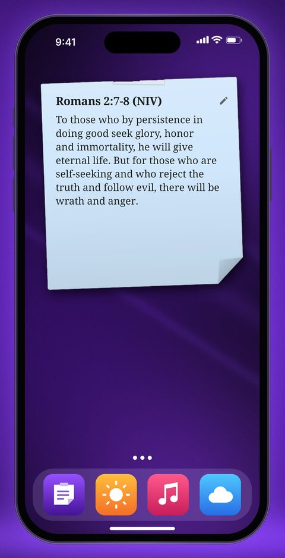
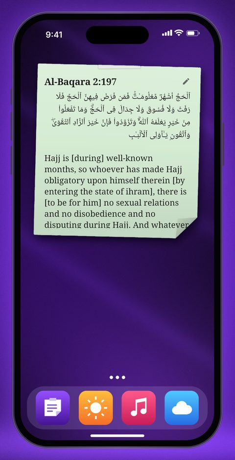
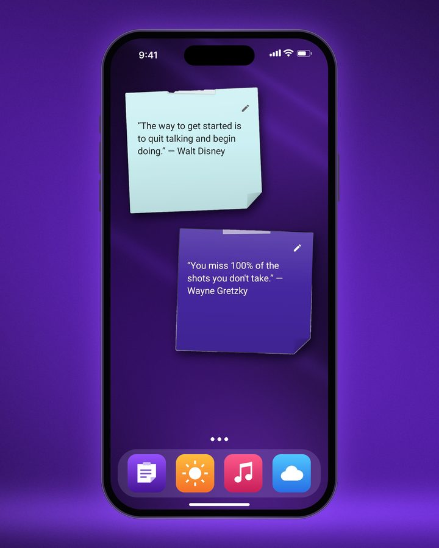

<p align="center">
  
</p>

<h1 align="center">Stickit</h1>

<p align="center">Sticky notes for your Android home screen.</p>

<p align="center">
  <a href="https://stickit.byisrael.tech/stickit.apk"><b>Download the APK</b></a> ·
  <a href="https://stickit.byisrael.tech">Website</a>
</p>

<p align="center">
  
  
  
</p>

## Features

- Notes and checklists as home screen widgets
- Handwritten look by default (Hand and Marker fonts), or pick Sans, Serif or Mono
- Drag to pick a widget size (2×1 up to 4×4), even on launchers that can't resize widgets
- Tick checklist items right from the widget
- Show a note on your lock screen
- Optional Bible and Quran verse that changes every hour
- No account, no ads

## Build

```bash
flutter pub get
flutter build apk --release --split-per-abi
```

## Contact

Made by [Israel Ashenafi](https://israelashenafi.com) · Telegram [@israelashenafi](https://t.me/israelashenafi) · Channel [@Atomic_izzy](https://t.me/Atomic_izzy)

## Fonts

[Patrick Hand](https://fonts.google.com/specimen/Patrick+Hand) (SIL OFL 1.1) and [Permanent Marker](https://fonts.google.com/specimen/Permanent+Marker) (Apache 2.0). Licenses are in `assets/fonts/`.
